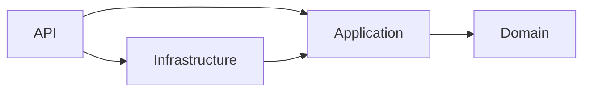

# Architecture

One deployable ASP.NET Core process and one PostgreSQL database. Modules cover identity, seller onboarding, catalog, campaigns/reservations and audit. The generic Seller and Product concepts allow future categories without embedding kirana assumptions in core types. Only physical products and pickup fulfillment are currently supported.

Dependency direction:

Infrastructure implements application ports using EF Core and Identity. Application owns immutable API DTOs, request validation and service interfaces. Domain owns entities, state transitions and reservation eligibility rules. API endpoints bind requests, derive the actor from validated JWT claims, invoke services, and select HTTP responses. Domain has no EF or ASP.NET references.

The application workflows currently live in the Infrastructure adapter alongside their transaction boundaries. This keeps the application ports infrastructure-independent without introducing a repository per table. For larger modules, move orchestration behind database-independent unit-of-work ports as needed.

UTC is represented by DateTimeOffset with zero offset; campaign inputs with nonzero offset are rejected. TimeProvider is injectable. All lists use bounded pagination and deterministic ordering; totals can change between concurrent reads. Public browsing returns approved active sellers, active products/categories, and reviewed campaigns. Seller-only drafts remain private.

ICampaignExpiryProcessor is the background-processing port. A BackgroundService polls every 15 seconds in batches of 100. Each candidate gets its own DI scope, DbContext and transaction, with bounded lock and command timeouts. Multiple workers may find the same rows but recheck under PostgreSQL locks. Per-campaign failure count and retry deadline persist in PostgreSQL; retries use 15–900 second bounded exponential backoff. A failing candidate does not abort later candidates. Nothing requires Redis or messaging infrastructure.

Audit events and internal notifications are saved in the same transaction as business writes. Notifications are the final database-backed delivery destination, with a unique recipient/event/entity deduplication key; there is no external publication or dispatcher gap. A future external provider must use a transactional outbox, not publish before commit. Logs contain event names, entity IDs, actor IDs and request trace identifiers, with no request-body, pickup-code or token logging. There are no outbound messages, payments, document uploads or deployments.

Sprint 2 extends the existing Marketplace adapter through a partial operations implementation behind IOperations. Inventory, confirmation, per-reservation pickup and notification entities remain generic. Seller operations lock seller first, then campaign, then pickup, serializing stock allocation and collection across one seller's campaigns. Inventory declarations additionally require an expected version; collection increments that version. Cancellation only needs a campaign lock and does not allocate/release whole-campaign stock. This deliberately favors a simple correctness boundary over maximum per-seller write throughput.

Operations health is Admin-only and reports persistent retry/overdue/legacy-work counts plus a process-local worker heartbeat. The heartbeat resets after restart; operational deadlines/retries and notification delivery do not depend on it. Database unavailable means the health request fails rather than falsely reporting healthy.
