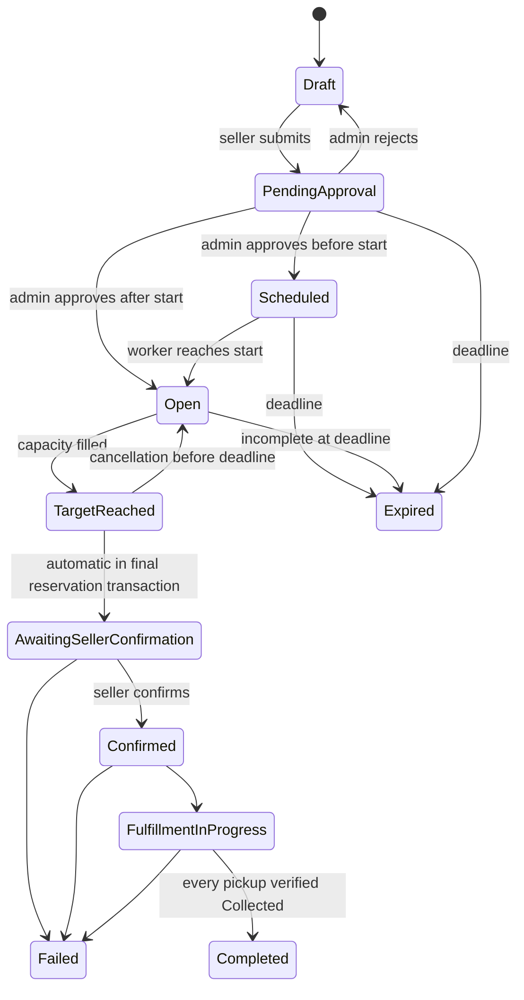

# Campaign and reservation lifecycle

The domain also permits Cancelled from draft/pending/scheduled/open/target-reached, reserved for a future campaign cancellation workflow; no public arbitrary status setter exposes these transitions. ReservedQuantity and approval states never come from create/update DTOs. Draft save checks stock; submit allocates the target under the seller lock; Admin rejection returns Draft and releases the commitment.

Draft edits only; submitted campaigns must be rejected back to Draft before editing. Approved sellers only may create/submit and confirm. Admins review campaigns but cannot skip the domain state machine. Final reservation applies TargetReached followed by AwaitingSellerConfirmation atomically, starts the configured confirmation deadline (default 60 minutes), and records seller notifications. Acquisition expiry does not erase a full campaign's confirmation window. Confirmation after that deadline conflicts even if the worker has not run; timeout ends Failed, expires active reservations and releases stock. Seller rejection has the same non-financial outcomes with a recorded actor/time/reason. Successful confirmation creates exactly one Pending pickup per active reservation, snapshots approved instructions, and sets the pickup deadline (default 48 hours).

Active reservations can cancel while Open and before acquisition deadline; cancellation and final reservation serialize on the campaign lock. In Sprint 2, filling the target closes cancellation automatically. A legacy TargetReached record still supports the old pre-deadline cancellation rule until reviewed cutover. Cancelled/Expired/Completed reservations are terminal. Seller readiness moves Confirmed to FulfillmentInProgress. Each successful code verification marks only that pickup Collected and its reservation Completed. All pickups must be Collected for successful group completion. Remaining Pending/Ready pickups become NotCollected at pickup deadline, reservations Expired, stock holds released, and the group Failed; already collected quantities remain fulfilled. Partial collection never becomes successful completion, and no state represents payment settlement.

The worker processes acquisition expiry, scheduled opening, confirmation expiry and pickup expiry. Candidate processing is isolated, retried with persistent bounded backoff and rechecked under locks, making ordinary retries/restarts idempotent. Application mutations independently check time. Completed, Expired and Failed campaign states are terminal. Legacy transition routes remain for compatibility but confirmation delegates to the inventory-backed decision path and manual Completed cannot bypass pickup evidence. A seller can report fulfillment failure from Awaiting/Confirmed/FulfillmentInProgress; uncollected pickups are Cancelled, active commitments Expired, and remaining stock is released. Collected evidence is retained.

Pickup lifecycle: Pending → ReadyForPickup → Collected; Pending/ReadyForPickup → NotCollected on deadline, or Cancelled on seller failure. Collected, NotCollected and Cancelled are terminal. Codes are requestable only by the owning customer while Ready, and only the owning seller may consume one. See fulfillment-workflow.md for payment eligibility, code recovery and accounting.
